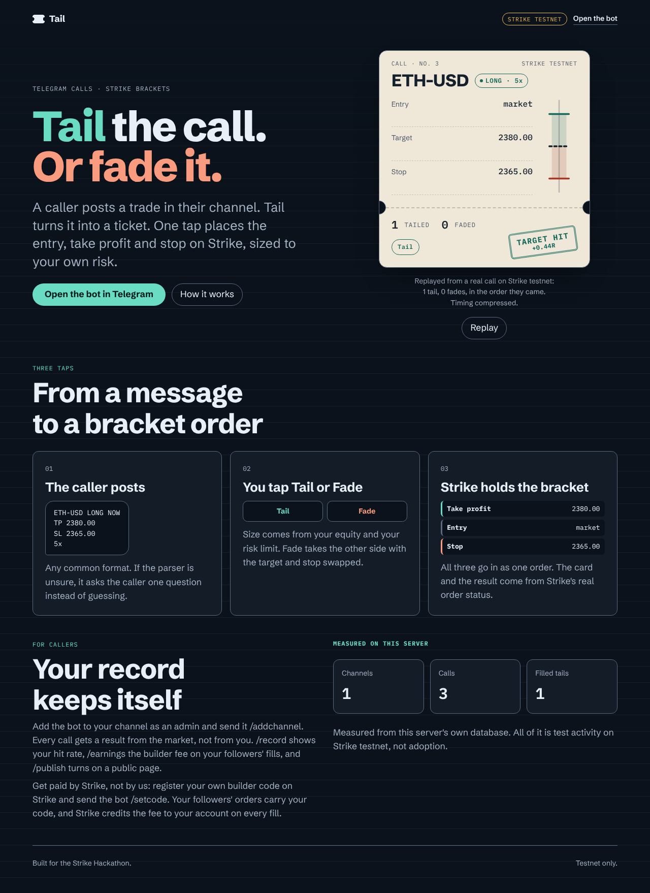
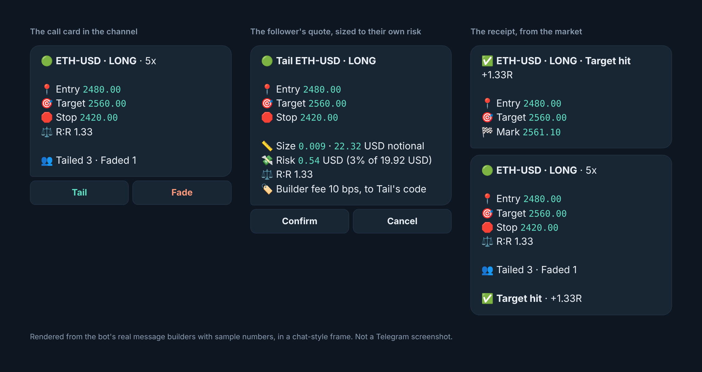
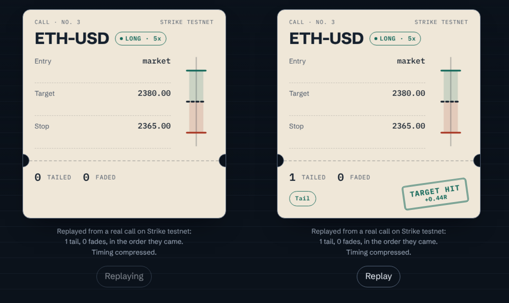
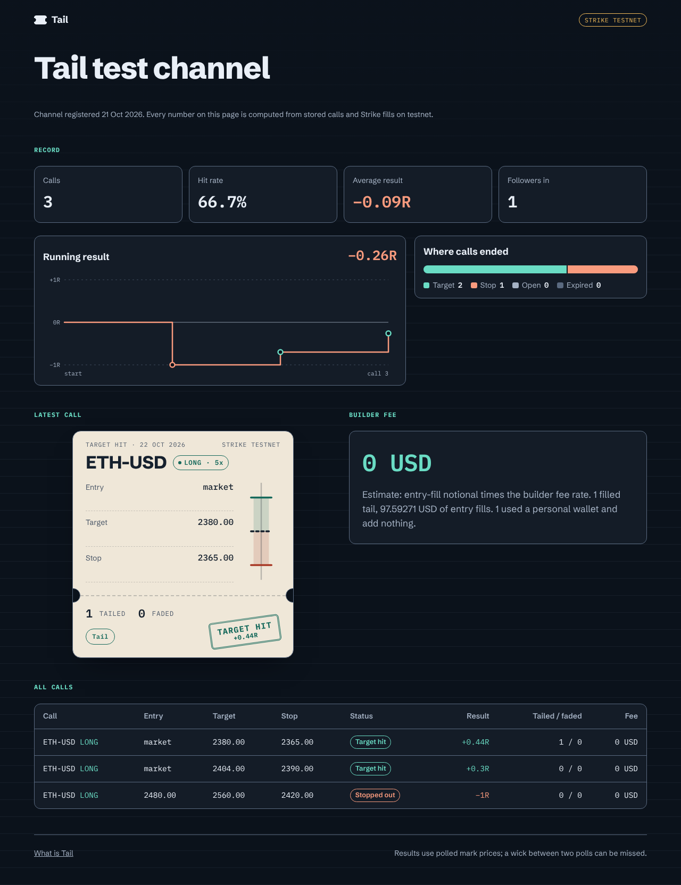
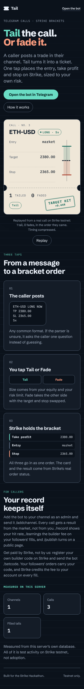
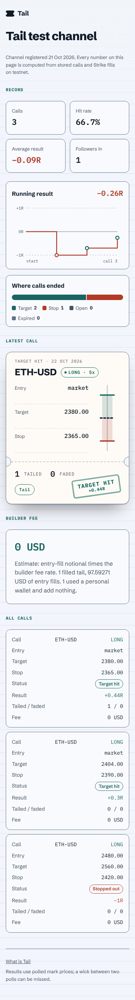

# Tail

**Tail the call. Strike does the rest.**

A caller posts a trade call in a Telegram channel. Tail turns it into a card with **Tail** and **Fade** buttons. One tap
places a Strike bracket order (entry, take profit and stop loss) sized to that follower's own risk. The caller is paid
the builder fee on their followers' fills, by Strike, through their own builder code.

Built for the Strike Hackathon (2026-10-21 to 2026-10-23). **Strike testnet only.** Decisions and spike results are in
[DECISIONS.md](DECISIONS.md); every claim on this page maps to a command in [CLAIMS.md](CLAIMS.md).

<p align="center"></p>

## The problem

Signal channels move at the speed of a message. A follower reads a call, opens an exchange, picks the market, types an
entry, sets a target and a stop, and works out a size, and by then the entry has gone. The caller, whose call moved the
money, earns nothing from any of it.

Tail removes the typing and the arithmetic. The caller's message becomes the order, sized from the follower's own equity
and risk limit, and Strike holds the entry, target and stop as one bracket.

## What it looks like

**In Telegram.** Every message below is built by the bot's real message code.

<p align="center"></p>

*The images above are the bot's real message builders rendered with sample numbers in a chat-style frame. They are not
Telegram screenshots.*

**On the web.** The home page replays the newest call that real followers took: the follows land in the order they came,
then the result is stamped. Nothing is staged; with no call it says so.

<p align="center"></p>

A caller can publish a public record page. Every number on it is computed from stored calls and Strike fills.

<p align="center"></p>

<p align="center"> &nbsp; </p>

## Status

Each line says LIVE, NEXT or NOT LIVE. Nothing is marked LIVE until it has been run.

| Piece | Status | Note |
|---|---|---|
| Call parser (compact, block, emoji, market entries) | LIVE | `npm test`. Asks a question instead of guessing |
| Position sizing (risk, notional, leverage, lot step) | LIVE | `npm test`. Floors to the lot step, never rounds up |
| Fade (flip side, swap TP and SL, show the inverted reward-to-risk) | LIVE | `npm test` |
| Strike request signing (Ed25519) | LIVE | `npm test` (RFC 8032 vector); Strike accepted a signed `GET /v2/account` on testnet, `docs/proof/spike-a.json` |
| Strike client, bracket order from the CLI | LIVE | `scripts/tail-once.ts`, testnet, ETH-USD. Proof: `docs/proof/p2-tail-once.txt` |
| Telegram: read channel posts, post cards with deep-link buttons, edit them | LIVE | Spike D: `docs/proof/spike-d.json` |
| Telegram bot: register a channel, confirm a call, post the card, Tail and Fade quotes, place a bracket | LIVE | Ran end to end on testnet from real taps: Strike order 243140879. `docs/proof/p3-live.json` |
| Builder Connect from a script (Solana wallet) | LIVE | `scripts/scripted-follower.ts`, testnet. Fees on orders: NEXT |
| Connect page: one wallet signature links a follower (MetaMask, Rabby, Phantom, Lace, Eternl) | NEXT | Built; browser-tested locally against real Strike testnet with a scripted Ethereum wallet (`scripts/e2e-connect.ts`). Not deployed |
| Deployment (Docker, Render free plan, `docs/DEPLOY.md`), with a strict Content-Security-Policy | NEXT | Deployed by the owner on Render's free plan. Not yet checked end to end: the webhook, the live pages and a real order from a second account |
| Live card state: counters from Strike's real order status, call results with a receipt, caller record (`/record`) | LIVE | Ran on testnet against the real dev database: `docs/proof/p5-live.json`. A fresh fill-to-close run with a follower is still to do |
| Builder fee on orders | NEXT | Sent for builder wallets (Tail's code, or the caller's own); the quote shows it. Not yet seen on a fill |
| Guard rails (rate limits, duplicate window, open-tail cap), ask flow, plain rejection reasons | LIVE | `npm test`. Reasons come from Strike strings seen live. A follower tap on this build placed Strike order 243144232 (`docs/proof/p6-live-tail-3.json`). Fade: unit-tested, not run live |
| AI fallback for unreadable calls (OpenRouter, caller must confirm) | LIVE | Off without `OPENROUTER_API_KEY`. `docs/proof/p6-ai-live.json`. Numbers in a message are trusted by design; the caller's tap is the gate |
| Caller earnings estimate (`/earnings`) and public record page (`/publish`, `/c/<slug>`), home page | LIVE | Run locally against the real dev data (not deployed): 8 widths, both themes, numbers equal the SQL in `CLAIMS.md`, a real-call replay with charts (`scripts/replay-probe.ts`). The fee is an estimate: Strike's fill has no builder-share field |
| Caller payout: a caller sets their own Strike builder code (`/setcode`); follows from their card trade under it, so Strike credits the fee to them directly | NEXT | Built and tested; code check live (`sigma` ok, unknown 404). Not yet seen on a real fill under a caller code |

## How it works

```
caller post -> parser -> draft the caller confirms -> card in the channel [Tail] [Fade]
follower taps -> bot DM -> sizing from the follower's own equity and caps -> confirm -> Strike bracket order
Strike's real order status -> card counters, receipts, the caller's record
```

- **The model never builds an order.** Parsing and sizing are plain, tested code. If a call is ambiguous (no side, two
  possible entries, a stop on the wrong side of the entry) the bot asks one question. An optional AI reader can propose
  a reading of a message the parser cannot read; every number in it must appear in the message, the parser re-checks it, and
  the caller must confirm it before anything is posted.
- **Sized to the follower.** Risk percent of equity, a maximum notional and a maximum leverage, floored to the market's lot
  step. It never rounds up.
- **Fade** takes the other side with the target and stop swapped.
- **Strike is the source of truth.** A 201 from the order endpoint only means the order was sequenced, so the bot reads the
  order's final status. Counters, fills, closes and results come from Strike, not from the bot's own rows.
- **Results are judged from market prices**, polled every 30 seconds. A wick between two polls can be missed, and the
  pages say so.

## How callers are paid

Strike credits a builder fee to the account that owns the builder code on an order. So a caller registers their own code
on Strike and sends the bot `/setcode THEIRCODE 10`. The bot checks the code with Strike, and followers of that channel
connect once under it. Their orders carry the caller's code, so **Strike pays the caller directly and Tail never holds
the money.** Without a code, orders carry Tail's code and the fee goes to Tail's account. The follower's quote shows the fee
rate and who receives it before they confirm.

Strike's fill record has no builder-share field, so the figure shown for a caller (`/earnings`, the record page) is an
estimate: entry-fill notional times the builder fee rate.

## How it uses Strike

| Strike feature | Use |
|---|---|
| `POST /v2/order/strategy` | entry, take profit and stop loss in one request; the final status is read afterwards |
| `GET /v2/order`, `/v2/history/fill`, `/v2/positions`, open orders | reconciliation: fills, rejections, cancellations, closed positions |
| `GET /v2/account` | follower equity (`margin_balance`) for sizing |
| `GET /price/v2/exchangeInfo`, mark price | listed markets, tick and lot size; the mark for market entries and results |
| API wallets (Ed25519 signed requests) | trade on the follower's behalf; a withdrawal still needs the follower's own wallet signature |
| Builder Connect (`request-signature`, `verify-signature`) | one wallet signature links a follower: Ethereum, Solana or Cardano |
| `X-Builder-Fee-Bps` | the caller's fee on each order |

## Safety

- **Tail cannot move your funds out.** The API wallet Tail holds can place orders, but a withdrawal needs your own wallet's signature and always goes to your registered address (VERIFIED: Strike's builder-code withdraw docs). Tail never holds funds.
- **Keys are encrypted at rest** (AES-256-GCM, `TAIL_KEK`), never logged and never returned by any route. `/revoke` deletes
  every stored key for the user.
- **Connect links** are single-use, expire in 10 minutes, are bound to one Telegram user and are rate limited.
- **Web pages** are served with a strict Content-Security-Policy: their own scripts only, no framing.
- **Abuse limits:** per-user rate limit, calls per channel per hour, open tails per follower, a duplicate-call window.
- Hardening checklist, with each item's result: [DECISIONS.md](DECISIONS.md) ("P9").

## Run it

Node 22.

```
npm ci
npm test                     # all tests
npm run test:cov             # coverage for src/core and the request signing
cp .env.example .env         # fill in your own testnet values
npm run web:build            # builds the web pages
npm start                    # dev mode: long polling on a dev bot token
```

`.env` holds `TELEGRAM_BOT_TOKEN`, `TAIL_KEK` (`openssl rand -base64 32`), `BUILDER_CODE` and, for the dev-only `/link`
shortcut, a testnet API wallet key. Never commit it; `npm run check:push` scans for key patterns before a push.

Deploying (Docker, Render's free plan, webhook mode): [docs/DEPLOY.md](docs/DEPLOY.md).

### Browser checks

```
npm run web:build
npx tsx scripts/pages-e2e.ts      # 116 checks: 8 widths x 2 themes, page numbers equal the SQL in CLAIMS.md
npx tsx scripts/replay-probe.ts   # the home-page replay, with motion on and off
npx tsx scripts/contrast.ts       # WCAG contrast of every colour pair, both themes
```

## Project layout

| Path | What is in it |
|---|---|
| `src/core/` | parser, sizing, fade, outcome rules, record, earnings: pure code, no I/O |
| `src/strike/` | the signed Strike client, request signing, builder-code check |
| `src/bot/` | message copy, the service (every user action) and the grammY wiring |
| `src/jobs/` | outcomes, reconciliation and the scheduler |
| `src/db/` | SQLite store, versioned migrations, key encryption |
| `src/web/`, `web/` | the API and the Vite and React pages |
| `scripts/` | spikes, live proofs, browser checks |
| `docs/` | deploy guide, proofs and screenshots |

## Testnet notes

Testnet order books are thin. Only ETH-USD has a book that agrees with its mark price; limit orders on ADA-USD, SOL-USD
and BTC-USD were rejected as `order_price_out_of_limit` (details in [DECISIONS.md](DECISIONS.md)). Market fills on a thin
book can land past a call's own target. Demos run on ETH-USD.

## What Tail is not

- Not a trading terminal and not a Telegram Mini App.
- It holds no funds, and it cannot withdraw anyone's funds without their wallet signature.
- Not on mainnet.
- Test activity is not adoption. Every number shown on a page comes from real rows and is labelled as test activity.
